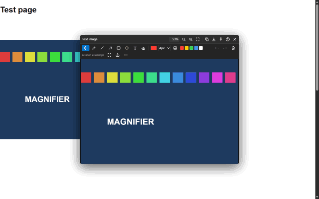

# Image Magnifier

> A Tampermonkey userscript that opens any image in a floating zoom window with a double Ctrl press.
> Pan, zoom, resize the window, and annotate images with drawing tools — pencil, line, arrow,
> rectangle, ellipse, text and an eraser. Pick colours from a round HSV wheel, flip a pixel grid on
> for pixel art, and undo or redo anything you draw.
>
> **Author:** diple_df x claude · **Version:** 3.14.1

### Demo

Zoom to the cursor, draw on the image, and export — all inside the page.

## Installation

### Step 1 — Install a Userscript Manager

The script requires a browser extension to run. Supported managers:

| Extension | Chrome | Firefox | Edge |
|---|---|---|---|
| **Tampermonkey** (recommended) | ✓ | ✓ | ✓ |
| Violentmonkey | ✓ | ✓ | ✓ |
| Greasemonkey | — | ✓ | — |

Install the extension from your browser's official add-on store.

### Step 2 — Install the Script

**Option A — 1-click install (recommended):**

1. Click the automatic install link: **[Install Image Magnifier](https://raw.githubusercontent.com/diple-df/Image-Magnifier/main/imgMagnifier.user.js)**
2. Tampermonkey will automatically intercept the file and open the installation prompt
3. Click **Install**

**Option B — manually:**

1. Copy the contents of `imgMagnifier.user.js`
2. Open Tampermonkey → **Create a new script**
3. Paste the code and press **Save** (`Ctrl+S`)

### Step 3 — Use It on Any Page

Navigate to any website with images. Hover over an image and press **Ctrl twice** — the magnifier window will open.

---

## How to Use

1. Hover your mouse over any image on a webpage
2. Press **Ctrl** twice quickly — the image opens in a floating window
3. **Scroll** the mouse wheel to zoom in and out (zoom anchored to the cursor position)
4. **Click and drag** inside the viewport to pan the image (or hold **Space**, or the middle button)
5. **Drag** the title bar to reposition the window
6. **Resize** the window from the bottom-right corner
7. Press **Ctrl** twice again, press **Esc**, or click outside the window to close it

### What counts as an image

The window opens only on something that is actually worth magnifying. A press over
empty page area does nothing, and it never grabs a picture from elsewhere on the page.

| Target under the cursor | Result |
|---|---|
| Photo, screenshot, picture element, canvas | opens |
| Element with a `background-image` | opens |
| Link or card wrapping exactly one image that fills it | opens |
| 1×1 tracking pixel, spacer, invisible image | ignored |
| Icon or thumbnail under 24 px | ignored |
| Card, list or container full of other content | ignored |
| Plain text, empty background, page margins | ignored |

---

## Features

### Zoom

Mouse wheel zooming is anchored to the cursor position — the point under your cursor stays fixed while everything else scales around it. Zoom range: 5% to 2000%. Trackpads zoom smoothly instead of jumping in coarse steps.

The current zoom level is shown in the title bar. **Click the percentage** to reset to 100% (`Ctrl+0`). Above 300% the image is drawn without smoothing, so you can inspect individual pixels.

Large images are drawn from a prebuilt mipmap pyramid (1/2, 1/4, 1/8), so panning and zooming stay smooth on multi-megapixel pictures. Movement also reuses a small cache of the last few zoom/pan states instead of redrawing from scratch. When the window is moved to a display with a different pixel density, the backing store is rebuilt so the picture never turns blurry; the DPR cap stays in place.

### Toolbar buttons

| Button | Action |
|---|---|
| **%** | Click to reset zoom to 100% |
| **−** | Zoom out (centered) |
| **+** | Zoom in (centered) |
| **⊡** | Fit image to window (`Ctrl+1`) — also scales small pictures up, capped at 4x |
| **📌** | Pin the window — an outside click no longer closes it (`Shift+P`) |
| **?** | Shortcut help overlay |
| **⚙** | Interface settings — hide whole groups or individual buttons |
| **⋯** | More: pin, translucency, look-only, pixel grid, reset view |
| **×** | Close the window |

### Layout

The window has three zones:

- **Tool rail (left)** — annotation tools and action buttons, grouped into
  collapsible categories: *Drawing*, *View*, *History*. *View* holds the pixel
  grid, *History* holds undo, redo and clear. Drag a category header to reorder
  it, click a header to collapse it, or press `Alt+↑` / `Alt+↓` on a focused
  header.
- **Canvas (centre)** — the image plus a status bar underneath showing the
  active tool, its gesture hint, the annotation count and the current zoom.
- **Properties panel (right)** — settings for the active tool. It starts
  folded into a 26 px strip so the picture, not the interface, is what you see
  first. Move the pointer to the right edge of the window and the panel slides
  open with a short 130 ms animation; move away and it folds again.

Everything above is optional: **⚙ → Blocks** hides the rail, the properties
panel or the status bar entirely, and **⚙ → Presets** switches between
*Everything visible*, *View only* and *Drawing only* in one click.

### Drawing Tools

The rail under the *Drawing* category provides annotation tools:

| Tool | Key | Description |
|---|---|---|
| **Move** | `V` / `8` | Pan the image (default; also pan anytime with **Space** held or the middle mouse button) |
| **Pencil** | `P` / `1` | Freehand drawing |
| **Line** | `L` / `2` | Straight line |
| **Arrow** | `A` / `3` | Arrow between two points |
| **Rectangle** | `R` / `4` | Rectangle |
| **Ellipse** | `E` / `5` | Ellipse (circle when constrained) |
| **Text** | `T` / `6` | Click to place text, type, `Enter` to commit |
| **Eraser** | `X` / `7` | Drag over shapes to remove them |

Modifiers while drawing:

- **Shift** — constrain to a square / circle / 45° angles
- **Alt** — draw from the center outwards
- **Alt + drag a shape** — duplicate it with an offset
- **Ctrl + drag a shape** — copy it in place

Shape tools can be filled with the fill toggle in the toolbar.

### Colour picker

The properties panel holds a round HSV wheel: hue runs around the rim,
saturation grows outwards from the white centre, and a **V** slider below sets
brightness. Click or drag anywhere on the wheel to pick a colour; the marker
follows the pointer and the HEX value is shown above it. There is no system
colour dialog anywhere in the window.

### Editing annotations

Annotations are hit-tested with a bounding box plus tolerance, so a single shape can be selected:

- **Double-click a shape** — select it and open a small editor: delete, duplicate, recolour, or edit the text
- **Drag a shape** in Move mode — reposition it
- **Delete** / **Backspace** — remove the selected shape
- **Esc** — first clears the selection, then closes the window

### Text Tool

1. Pick the **T** tool and click the image where the text should go
2. Type. Use **Shift+Enter** for a line break
3. **Enter** or a click on the image commits; **Esc** cancels; clicking elsewhere commits

Text is stored in image coordinates, so it stays glued to the same spot when you zoom or pan,
keeps its size relative to the picture, and lands in the exported image exactly where you saw it.
The text color follows the current color picker value; the font size follows the line width selector.
After committing, the tool returns to **Move** so you can pan immediately. Empty text is discarded.

### Undo / Redo

- `Ctrl+Z` — undo
- `Ctrl+Shift+Z` or `Ctrl+Y` — redo
- The trash button clears all annotations — and that is undoable too

### Pin, transparency and look-only mode

**📌** (or `Shift+P`) pins the window so an outside click no longer closes it — handy when
tracing or comparing against the page. **Ещё → Полупрозрачное окно** fades it to 82%, and
**Ещё → Режим «только смотреть»** lets clicks pass through the picture so you can work on the
page underneath while the reference stays visible.

### Pixel grid for pixel art

**Ещё → Сетка пикселей** (or `G`) draws a thin per-pixel grid with coordinates once the
effective zoom reaches 800%. It is off by default and remembered between sessions.

### Large images

A 48-megapixel photo used to freeze the tab for about a third of a second when the window opened,
because the script rescaled the full-size source on the main thread. It now works in the background
instead: the image is copied down in horizontal bands through `requestIdleCallback`, and every pixel
probe (mipmap build) waits for that smaller copy. Measured on an 8000x6000 source in
headless Edge: zero long tasks on open, zero during a 40-step zoom, and the full 2000% range still
reaches. Only the visible region is drawn each frame, so cost follows the window size, not the photo.

### Opening behaviour

Every image opens **fitted to the window**, so the whole picture is visible immediately — scrollbars
are acceptable, a cropped first view is not. Small pictures are scaled **up** to fill the window too
(capped at 4x, so a 16 px icon does not turn into a blur), which is why a 320x240 image now fills a
640 px window at about 170% instead of sitting at 100% in the middle. Previously the zoom level from
the last session was restored, which could leave a large photo showing only a corner on open; that
restore is gone.

### Small windows

Below 520 px of window width the interface switches to a compact mode, and below 380 px to a tiny
one: the rail narrows from 62 to 42 px, rail buttons from 56x27 to 26x24, the properties panel from
186 to 150 px and the title bar from 38 to 32 px. The colour wheel shrinks with it, so a 300 px wide
window still shows canvas, tools and colour at once without horizontal scrolling.

### The properties panel

The right-hand panel starts **collapsed** into a 26 px strip, so the image — not the interface — is
what you see when the window opens. Move the pointer to the right edge of the window and the panel
slides out; move away and it folds back. Only the window itself can be pinned (📌 / `Shift+P`) —
the panel is always hover-driven.

### Floating window ergonomics

The window itself can be dragged by the title bar and resized from the bottom-right corner. Window
size, position and drawing colour are remembered. The zoom level is deliberately **not** restored —
every image opens fitted to the window. Everything runs locally: no network requests at runtime
beyond loading the image you asked to inspect.

---

## Keyboard Shortcuts

| Key | Action |
|---|---|
| `Ctrl` × 2 | Open / close the magnifier |
| Wheel | Zoom at cursor |
| `↑` `↓` `←` `→` | Pan (`Shift` for larger steps) |
| `+` / `−` | Zoom in / out |
| `Ctrl+0` | Zoom to 100% |
| `Ctrl+1` | Fit image to window |
| `Space` (hold) | Temporary pan, any tool |
| Middle mouse | Pan |
| `Tab` / `Shift+Tab` | Cycle toolbar controls, trapped inside the window |
| `Enter` | Activate the focused button |
| `1` … `6` | Select tool |
| `Ctrl+Z` | Undo |
| `Ctrl+Shift+Z` / `Ctrl+Y` | Redo |
| `Shift` | Constrain square / circle / 45° |
| `Alt` | Draw from center |
| `Alt` + drag | Duplicate the last shape with an offset |
| `Ctrl` + drag | Copy a shape |
| Double-click a shape | Select and edit it |
| `Delete` | Remove the selected shape |
| `C` | Focus the colour picker |
| `G` | Toggle the pixel grid (from 800%) |
| `Shift+P` | Pin / unpin the window |
| `V` `P` `L` `A` `R` `E` `T` | Select tool (legacy letters) |
| `?` | Shortcut help |
| `Esc` | Clear selection / close help / close window |

Status messages are announced to screen readers through an `aria-live` region, and the Tab key
never escapes the window onto the page.

Shortcuts never fire while you are typing in the page's own inputs, and single-key shortcuts
only respond while the pointer is over the magnifier window.

### Updating

`@downloadURL`/`@updateURL` point at this single file, so Tampermonkey updates it in place.
The script also checks for updates on its own: once a day, in the background after the page
loads (skipped while the magnifier window is open), never more than one request per day.
**Tampermonkey menu → Image Magnifier: Проверить обновления** runs a check on demand. When a
newer version exists, a dismissible banner links to the raw file and appears once per version.
Version segments are compared numerically, so `3.14.1` is correctly newer than `3.9.0`.

### Script Version

| File | Script Name | Version | Status |
|---|---|---|---|
| `imgMagnifier.user.js` | Image Magnifier | 3.14.1 | Current — installable |

---
