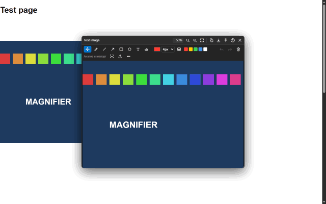

# Image Magnifier

> Userscript для Tampermonkey, который открывает любое изображение в плавающем окне с зумом по двойному нажатию Ctrl.
> Панорамирование, масштабирование, изменение размера окна и аннотирование изображений —
> карандаш, линия, стрелка, прямоугольник, эллипс и текст, — а также палитра изображения,
> выпрямление перспективы, чтение текста и QR-кодов и экспорт в PNG / JPEG / WebP.
>
> **Автор:** diple_df x claude · **Версия:** 3.11.0

### Демонстрация

Зум к курсору, рисование по картинке и экспорт — всё прямо на странице.

## Установка

### Шаг 1 — Установите менеджер userscript'ов

Для работы скрипта требуется браузерное расширение. Поддерживаемые менеджеры:

| Расширение | Chrome | Firefox | Edge |
|---|---|---|---|
| **Tampermonkey** (рекомендуется) | ✓ | ✓ | ✓ |
| Violentmonkey | ✓ | ✓ | ✓ |
| Greasemonkey | — | ✓ | — |

Установите расширение из официального магазина дополнений вашего браузера.

### Шаг 2 — Установите скрипт

**Вариант А — установка в один клик (рекомендуется):**

1. Нажмите на ссылку автоматической установки: **[Установить Image Magnifier](https://raw.githubusercontent.com/diple-df/Image-Magnifier/main/imgMagnifier.user.js)**
2. Tampermonkey автоматически перехватит файл и откроет страницу установки
3. Нажмите **Установить**

**Вариант Б — вручную:**

1. Скопируйте содержимое файла `imgMagnifier.user.js`
2. Откройте Tampermonkey → **Создать новый скрипт**
3. Вставьте код и нажмите **Сохранить** (`Ctrl+S`)

### Шаг 3 — Используйте на любой странице

Откройте любой сайт с изображениями. Наведите курсор на картинку и нажмите **Ctrl дважды** — откроется окно лупы.

---

## Как пользоваться

1. Наведите курсор мыши на любое изображение на веб-странице
2. Быстро нажмите **Ctrl дважды** — изображение откроется в плавающем окне
3. **Прокручивайте** колёсико мыши для масштабирования (зум привязан к позиции курсора)
4. **Нажмите и тащите** внутри области просмотра для панорамирования (или удерживайте **Пробел**, или СКМ)
5. **Тащите** за заголовок окна, чтобы переместить его
6. **Изменяйте размер** окна за правый нижний угол
7. Нажмите **Ctrl дважды**, **Esc** или кликните за пределами окна, чтобы закрыть его

### Что считается изображением

Окно открывается только на том, что действительно стоит увеличивать. Нажатие по пустому
месту страницы ничего не делает и никогда не подхватывает картинку из другого её конца.

| Что под курсором | Результат |
|---|---|
| Фотография, скриншот, `picture`, canvas | открывается |
| Элемент с фоновым изображением (`background-image`) | открывается |
| Ссылка или карточка, внутри которой ровно одно изображение и оно занимает её целиком | открывается |
| Трекинг-пиксель 1×1, спейсер, невидимое изображение | игнорируется |
| Иконка или превью меньше 24 px | игнорируется |
| Карточка, список или контейнер с другим содержимым | игнорируется |
| Просто текст, пустой фон, поля страницы | игнорируется |

---

## Возможности

### Масштабирование

Зум колёсиком мыши привязан к позиции курсора — точка под курсором остаётся на месте, а всё остальное масштабируется вокруг неё. Диапазон масштаба: от 5% до 2000%. Тачпады масштабируют плавно, без рывков.

Текущий уровень масштаба отображается в заголовке окна. **Нажмите на проценты**, чтобы сбросить до 100% (`Ctrl+0`). Выше 300% картинка рисуется без сглаживания — можно рассматривать отдельные пиксели.

Крупные изображения рисуются из заранее построенной пирамиды уровней (1/2, 1/4, 1/8), поэтому панорама и зум остаются плавными на много-мегапиксельных картинках. Перемещение также переиспользует небольшой кэш последних состояний зума/панорамы вместо полной перерисовки. При переносе окна на монитор с другой плотностью пикселей холст пересобирается, поэтому картинка не становится мыльной; ограничение DPR сохранено.

### Кнопки панели управления

| Кнопка | Действие |
|---|---|
| **%** | Сброс масштаба до 100% |
| **−** | Отдалить (по центру) |
| **+** | Приблизить (по центру) |
| **⊡** | Вписать изображение в окно (`Ctrl+1`), но не крупнее 100% |
| **⧉** | Скопировать изображение с аннотациями (`Ctrl+C`) |
| **↓** | Сохранить изображение (`Ctrl+S`) в формате, выбранном в меню **Экспорт** |
| **📌** | Закрепить окно — клик мимо больше не закрывает его (`Shift+P`) |
| **?** | Справка по горячим клавишам |
| **⚙** | Настройки интерфейса — скрыть целые блоки или отдельные кнопки |
| **⋯** | Ещё: закрепление, прозрачность, «только смотреть», сетка, сброс вида |
| **×** | Закрыть окно |

### Устройство окна

В окне три зоны:

- **Рейка инструментов (слева)** — инструменты и кнопки действий, разбитые
  на сворачиваемые категории: *Рисование*, *Распознавание*, *Анализ*, *Файл*,
  *История*. Заголовок категории можно перетащить, чтобы поменять порядок,
  кликнуть — чтобы свернуть, или нажать `Alt+↑` / `Alt+↓` на нём.
- **Холст (в центре)** — картинка, а под ней строка состояния: активный
  инструмент, подсказка по жесту, число пометок и текущий масштаб.
- **Панель свойств (справа)** — настройки активного инструмента. Кнопка внизу
  складывает панель в полоску шириной 30 px и освобождает место холсту;
  повторное нажатие возвращает её.

Всё перечисленное необязательно: **⚙ → Блоки интерфейса** полностью скрывает
рейку, панель свойств или строку состояния, а **⚙ → Наборы** одним кликом
переключает *Всё видно*, *Только просмотр* и *Только рисование*.

### Инструменты рисования

Инструменты аннотирования живут в категории *Рисование* на рейке:

| Инструмент | Клавиша | Описание |
|---|---|---|
| **Перемещение** | `V` / `8` | Панорамирование (режим по умолчанию; также **Пробел** или СКМ) |
| **Карандаш** | `P` / `1` | Произвольное рисование от руки |
| **Линия** | `L` / `2` | Прямая линия |
| **Стрелка** | `A` / `3` | Стрелка между двумя точками |
| **Прямоугольник** | `R` / `4` | Прямоугольник |
| **Эллипс** | `E` / `5` | Эллипс (с Shift — круг) |
| **Текст** | `T` / `6` | Клик по картинке, ввод текста, `Enter` — готово |
| **Ластик** | `X` / `7` | Провести по фигурам, чтобы стереть их |

Модификаторы при рисовании:

- **Shift** — квадрат / круг / углы по 45°
- **Alt** — рисовать от центра
- **Alt + перетаскивание фигуры** — дублировать её со смещением
- **Ctrl + перетаскивание фигуры** — копия на месте

Фигуры можно заливать — переключатель заливки на панели.

### Выбор цвета

В панели свойств лежит круглое HSV-колесо: оттенок идёт по ободу, насыщенность
растёт от белого центра к краю, а ползунок **V** под колесом задаёт яркость.
Клик или перетаскивание по колесу выбирает цвет; маркер следует за курсором,
HEX-значение показано над ним. Системного диалога выбора цвета в окне нет.

### Палитра изображения

**Анализ → Палитра изображения** берёт уменьшенную копию 64×64, квантует её по грубым бинам (4 бита на канал) и показывает 5–8 доминирующих цветов плашками. Клик по плашке копирует HEX **и** ставит цвет кисти, так что размечать можно в палитре самой картинки. Для кросс-доменных картинок холст защищён, поэтому скрипт забирает байты через `GM_xmlhttpRequest` (он не подчиняется CORS страницы) и строит палитру по этой копии.

### Перспективная коррекция

**Анализ → Выпрямить перспективу** просит указать четыре угла документа, доски или сфотографированного экрана. Картинка разворачивается в прямоугольник настоящей гомографией, с попиксельной выборкой в выходной холст разумного размера (ограничен по стороне и площади, чтобы огромное фото не подвесило вкладку). **Анализ → Показать оригинал** возвращает исходный вид. Пока показан исправленный вид, экспорт и буфер используют уже выпрямленную картинку.

### Чтение текста и кодов

Выделите прямоугольник — всё считается локально:

- **Прочитать текст** — использует `window.TextDetector`, если браузер его умеет. Честный фолбэк предлагается всегда: выделение увеличивается в 4× и кладётся в буфер, откуда его можно вставить в любой OCR-сервис. Без сети и без WASM-моделей.
- **QR-код / штрих-код** — использует `window.BarcodeDetector`, если он доступен. Для QR предлагается копировать значение и открыть ссылку, причём домен показывается до подтверждения. Если API нет, пункт не показывается вовсе, а не висит мёртвой кнопкой.

### Пресеты экспорта

**Экспорт** предлагает PNG, JPEG (с ползунком качества) и WebP, запоминает последний выбор и подставляет правильное расширение файла. `Ctrl+S` и кнопка сохранения работают в запомненном формате, поэтому привычное поведение не ломается. У JPEG подкладывается белый фон, чтобы прозрачность не стала чёрной. Копирование как PNG или JPEG — в том же меню.

### Правка аннотаций

Аннотации ищутся хит-тестом по рамке с допуском, поэтому можно выбрать отдельную фигуру:

- **Двойной клик по фигуре** — выбрать и открыть мини-редактор: удалить, дублировать, сменить цвет или изменить текст
- **Перетаскивание фигуры** в режиме «Перемещение» — сдвинуть её
- **Delete** / **Backspace** — удалить выбранную фигуру
- **Esc** — сначала снимает выделение, потом закрывает окно

### Инструмент «Текст»

1. Выберите инструмент **T** и кликните по изображению в нужном месте
2. Набирайте текст. **Shift+Enter** — перенос строки
3. **Enter** или клик по изображению — применить; **Esc** — отменить; клик мимо — применить

Текст хранится в координатах изображения, поэтому при зуме и панорамировании он остаётся
на том же месте картинки, сохраняет свой размер относительно неё и попадает в экспорт
ровно туда, где вы его видели. Цвет берётся из выбора цвета, размер шрифта — из выбора толщины.
После применения инструмент возвращается в режим **Перемещение**, чтобы сразу можно было панорамировать.
Пустой текст не создаёт аннотацию.

### Отмена и повтор

- `Ctrl+Z` — отменить
- `Ctrl+Shift+Z` или `Ctrl+Y` — повторить
- Кнопка-корзина очищает все аннотации — это тоже отменяется

### Экспорт с объединением слоёв

Два способа, оба дают **исходное разрешение картинки** с корректно масштабированными аннотациями:

- **ПКМ** по изображению → **Копировать изображение** / **Сохранить изображение как…**
- **`Ctrl+C`** / кнопка копирования, **`Ctrl+S`** / кнопка сохранения — экспорт выполняется в фоне

Для `Ctrl+C`/`Ctrl+S` нужно прочитать пиксели. Изображения с того же сайта и большинство CDN
работают сразу; для защищённых кросс-доменных картинок скрипт забирает байты через
`GM_xmlhttpRequest` (он не подчиняется CORS страницы) и работает с этой копией, поэтому
копирование и сохранение обычно проходят. Если картинка вообще не загрузилась, в окне появится
сообщение со ссылкой «Открыть в новой вкладке».

### Закрепление, прозрачность и режим «только смотреть»

**📌** (или `Shift+P`) закрепляет окно, и клик мимо больше его не закрывает — удобно
срисовывать или сверять со страницей. **Ещё → Полупрозрачное окно** делает окно на 82%
прозрачным, а **Ещё → Режим «только смотреть»** пропускает клики сквозь картинку, чтобы
можно было работать на странице под ней, пока референс остаётся на виду.

### Сетка пикселей для пиксель-арта

**Ещё → Сетка пикселей** (или `G`) рисует тонкую сетку по пикселям с координатами, как только
эффективный зум достигает 800%. По умолчанию выключена и запоминается между сессиями.

### Закрытие окна

Окно можно закрыть:

- Нажатием **Esc**
- Повторным двойным нажатием **Ctrl**
- Кликом в любом месте за пределами окна (если окно не закреплено)

Само окно таскается за заголовок и меняет размер за правый нижний угол. Размер, позиция и
масштаб запоминаются. Всё работает локально: никаких сетевых запросов во время работы,
кроме загрузки самой картинки.

---

## Горячие клавиши

| Клавиша | Действие |
|---|---|
| `Ctrl` × 2 | Открыть / закрыть лупу |
| Колесо | Зум к курсору |
| `↑` `↓` `←` `→` | Панорама (`Shift` — крупными шагами) |
| `+` / `−` | Приблизить / отдалить |
| `Ctrl+0` | Масштаб 100% |
| `Ctrl+1` | Вписать в окно |
| `Пробел` (удерживать) | Временная панорама любым инструментом |
| СКМ | Панорама |
| `Tab` / `Shift+Tab` | Обход кнопок окна, фокус не уходит на страницу |
| `Enter` | Нажать кнопку в фокусе |
| `1` … `6` | Выбор инструмента |
| `Ctrl+Z` | Отменить |
| `Ctrl+Shift+Z` / `Ctrl+Y` | Повторить |
| `Shift` | Квадрат / круг / 45° |
| `Alt` | Рисовать от центра |
| `Alt` + перетаскивание | Дублировать фигуру со смещением |
| `Ctrl` + перетаскивание | Копия фигуры |
| Двойной клик по фигуре | Выбрать и отредактировать |
| `Delete` | Удалить выбранную фигуру |
| `C` | Фокус на выбор цвета |
| `G` | Сетка пикселей (от 800%) |
| `Shift+P` | Закрепить / открепить окно |
| `Ctrl+C` | Копировать изображение с аннотациями |
| `Ctrl+S` | Сохранить в выбранном формате |
| `V` `P` `L` `A` `R` `E` `T` | Выбор инструмента (старые буквы) |
| `?` | Справка |
| `Esc` | Снять выделение / закрыть справку / закрыть окно |

Сообщения о состоянии озвучиваются экранному диктору через область `aria-live`, а `Tab`
никогда не уводит фокус из окна на страницу.

Горячие клавиши не срабатывают, пока вы печатаете в полях самой страницы, а одиночные
клавиши работают только когда курсор находится над окном лупы.

### Обновление

`@downloadURL`/`@updateURL` указывают на этот единственный файл, поэтому Tampermonkey
обновляет его на месте. Скрипт ещё и сам проверяет обновления: раз в сутки, в фоне после
загрузки страницы (проверка пропускается, пока открыто окно лупы), не чаще одного запроса
в сутки. **Меню Tampermonkey → Image Magnifier: Проверить обновления** запускает проверку
по требованию. Когда есть версия новее, появляется закрываемый баннер со ссылкой на raw-файл,
один раз на версию. Сегменты версий сравниваются численно, поэтому `3.11.0` корректно
новее `3.9.0`.

### Версия скрипта

| Файл | Название скрипта | Версия | Статус |
|---|---|---|---|
| `imgMagnifier.user.js` | Image Magnifier | 3.11.0 | Актуальная — для установки |

---
